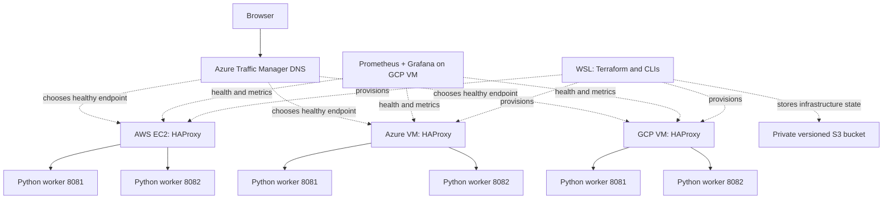

# Multi-cloud deployment and management: student lab

Prepared 14 October 2026 for Windows with WSL Ubuntu. AWS, Azure and GCP accounts are assumed available. This package contains a low-cost implementation candidate and a step-by-step deployment guide. It has not been deployed to your accounts. Read VALIDATION.md before applying.

## 1. What runs where

Your laptop runs the editor, Git, Terraform and cloud command-line tools. All application workers, load balancers, health probes, metrics storage and dashboards run in the cloud. Closing WSL after deployment does not stop the application. Accessing a cloud dashboard through an SSH tunnel does not host that dashboard on your laptop.



DNS is a naming service, not a traffic proxy: the browser connects directly to the selected VM. Priority mode selects AWS first, Azure second and GCP third. Weighted mode distributes DNS answers among healthy endpoints. DNS caching means it does not balance every HTTP request and failover is not instant. See [Traffic Manager routing](https://learn.microsoft.com/en-us/azure/traffic-manager/traffic-manager-routing-methods).

| Component | Configuration | Reason |
|---|---|---|
| AWS | Ubuntu 24.04, t3.micro, 8 GB gp3, static public IP | Small application host |
| Azure | Ubuntu 24.04, Standard_B1s, Standard disk, static public IP | Small second cloud host |
| GCP | Ubuntu 24.04, e2-small, 10 GB standard disk, static public IP | Third host plus monitoring; 2 GB memory gives monitoring more room |
| Local balancing | HAProxy to two independent systemd workers per VM | Demonstrates balancing and worker health checks without three managed LB charges |
| Global failover | Azure Traffic Manager, HTTP /health, 30-second DNS TTL | Provider-independent public endpoints; supplied DNS name needs no purchased domain |
| Monitoring | Prometheus, node exporter, blackbox exporter, Grafana, Alertmanager | Resource metrics, HTTP probes, dashboards and alert evaluation |
| Terraform state | Private encrypted, versioned S3 with lockfile | Cloud state storage and protection from concurrent writes |

These VM sizes are proposed defaults, not a claim of cheapest availability or free-tier eligibility. Confirm your subscription's region and SKU availability before applying.

## 2. Boundaries of this implementation

Included: three cloud networks and VMs; identical stateless demo applications; software load balancing; global health-based DNS routing; monitoring installation; alert rules; Grafana data source; remote-state bootstrap; validation CI and reviewed-plan CD configuration; outage and teardown instructions. For GitHub Actions, follow [CI-CD-SETUP.md](CI-CD-SETUP.md).

Two workers on one VM demonstrate process redundancy, not host redundancy within that cloud. A VM failure removes that entire cloud endpoint. Monitoring shares the GCP VM; losing it removes dashboards and local alerts while DNS failover remains separate. HTTP is suitable only for this public, non-sensitive demo. Metrics travel over public IPs restricted by source firewall rules, but are not encrypted. Use private connectivity or authenticated TLS before monitoring sensitive workloads.

Not implemented: managed cloud load balancers, multi-zone autoscaling, HTTPS/custom domain, Vault deployment, application database replication, object-data replication, cross-cloud billing ingestion or external alert credentials. CI/CD configuration is supplied; GitHub and cloud federation still require your account setup. The full project brief is broader than this low-cost first stage. Section 12 maps the remaining work; do not describe this lab as production-ready or claim completed database DR.

## 3. Cost controls before deployment

Create budgets and email alerts in AWS Billing, Azure Cost Management and GCP Billing at amounts that fit your available credits. Budget alerts are not guaranteed spending caps. Check the expiry and eligible services of each student-credit programme.

Estimate: running hours × each VM's hourly rate + disks + public IPv4 addresses + Traffic Manager queries/probes + storage + outbound transfer. No fixed price is quoted because regions, credits, SKUs and usage differ. Use the [AWS calculator](https://calculator.aws/), [Azure calculator](https://azure.microsoft.com/en-us/pricing/calculator/) and [GCP calculator](https://cloud.google.com/products/calculator). Run the lab during project sessions and destroy it afterwards. Stopped VMs can still incur disk and address charges.

There are no Kubernetes clusters, NAT gateways, managed databases or dedicated monitoring VM in this stage. AWS burst credits are set to standard to avoid surplus CPU credit charges; sustained load can instead be throttled. Prometheus retains up to three days or 512 MB of time-series blocks; this is not a complete disk cap.

## 4. Prepare Windows and WSL

In PowerShell, check the WSL installation you already use:

```powershell
wsl --list --verbose
```

Use your existing Ubuntu 24.04 distribution. If you have none, install it from an elevated PowerShell window and restart if Windows requests it:

```powershell
wsl --install -d Ubuntu-24.04
```

Copy the downloaded lab folder into Ubuntu's Linux filesystem, then work there:

```bash
mkdir -p ~/projects
cp -r /mnt/c/Users/thupe/Documents/Codex/2026-10-14/i-2/outputs/multicloud-student-lab ~/projects/
cd ~/projects/multicloud-student-lab
bash install-wsl-tools.sh
export PATH="$HOME/.local/bin:$PATH"
ssh-keygen -t rsa -b 4096 -f ~/.ssh/multicloud-lab -C multicloud-student-lab
```

Choose a passphrase for the new SSH key. Do not overwrite an existing key. Only the `.pub` file is sent to the providers. Never paste private keys or access tokens into chat or Git.

The installer uses the vendors' package repositories. Reference instructions: [Terraform](https://developer.hashicorp.com/terraform/tutorials/aws-get-started/install-cli), [AWS CLI](https://docs.aws.amazon.com/cli/latest/userguide/getting-started-install.html), [Azure CLI](https://learn.microsoft.com/en-us/cli/azure/install-azure-cli-linux?pivots=apt), [Google Cloud CLI](https://docs.cloud.google.com/sdk/docs/install-sdk).

## 5. Authenticate and check account access

AWS: use an IAM Identity Center profile if your account has one. You need its start URL, SSO region and assigned role from your account setup.

```bash
aws configure sso --profile student
aws sso login --profile student
export AWS_PROFILE=student
aws sts get-caller-identity
```

If Identity Center is unavailable, obtain a temporary role session through your account's supported sign-in process; do not use root access keys. AWS needs permission for EC2 networking, key pairs, instances, addresses and the state bucket. Use an isolated student account or scoped deployment role, not a production account.

Azure:

```bash
az login --use-device-code
az account list --output table
az account set --subscription 'YOUR-SUBSCRIPTION-ID'
az account show --output table
az provider register --namespace Microsoft.Compute --wait
az provider register --namespace Microsoft.Network --wait
```

Your identity must be able to create a resource group and its compute/network/Traffic Manager resources. Contributor on an isolated student subscription is a simple lab option; scope access further in a shared environment. Provider registration may need subscription-level rights.

GCP: select a project with billing enabled, then sign in twice: the first login is for the CLI; application-default credentials are for Terraform.

```bash
gcloud auth login --no-launch-browser
gcloud config set project YOUR-PROJECT-ID
gcloud auth application-default login --no-launch-browser
gcloud auth application-default set-quota-project YOUR-PROJECT-ID
gcloud services enable compute.googleapis.com
```

Typically the deployment identity needs Compute Admin, Service Usage Admin for enabling APIs, and Service Usage Consumer for quota use. Organisation policies can impose additional restrictions. No VM service account credentials are provisioned. If organisation policy requires OS Login, adapt the SSH configuration rather than attempting to disable that policy.

## 6. Configure cloud state

Terraform state records the resources it manages. Create its bucket separately so destroying the lab cannot also destroy the state bucket. Choose a globally unique lowercase bucket name:

```bash
terraform -chdir=bootstrap init
terraform -chdir=bootstrap plan -var='state_bucket_name=YOUR-UNIQUE-STATE-BUCKET' -out=bootstrap.tfplan
terraform -chdir=bootstrap apply bootstrap.tfplan
cp backend.tf.example backend.tf
cp backend.hcl.example backend.hcl
nano backend.hcl
```

Set the bucket name and matching region. The bootstrap state initially stays in `bootstrap/terraform.tfstate`; protect it and back it up to your private bucket after creation:

```bash
aws s3 cp bootstrap/terraform.tfstate s3://YOUR-UNIQUE-STATE-BUCKET/bootstrap/terraform.tfstate
terraform init -backend-config=backend.hcl
```

The lab's ongoing state now lives in S3. Never commit state, plans or credentials. The backend identity needs bucket listing and state-object read/write; lockfiles also need delete permission. See [S3 state and locking](https://developer.hashicorp.com/terraform/language/backend/s3). S3's availability is a dependency for infrastructure changes, not for serving the running app.

## 7. Configure and deploy

```bash
cp terraform.tfvars.example terraform.tfvars
nano terraform.tfvars
```

Replace the unique lowercase name, Azure subscription ID, GCP project ID, SSH public-key path and `admin_cidr`. The latter must be your current public IPv4 plus `/32`, not your WSL or Wi-Fi private address. You can check it with `curl -4 https://checkip.amazonaws.com`; this contacts the AWS IP-check service. Change regions and sizes if your credits or quota require it; keep the GCP zone in the selected region.

```bash
terraform fmt -check -recursive
terraform validate
terraform plan -out=lab.tfplan
terraform apply lab.tfplan
terraform output
```

Review the plan before the apply command, which creates billable resources. Commit `.terraform.lock.hcl` after initialization to record provider versions. Do not use `-auto-approve` for your first deployment. Allow several minutes after Terraform completes for Ubuntu to finish package installation.

Visit the `app_url` output. It returns a small JSON response showing cloud, worker port and health. This is deliberately a stateless application so traffic can move between providers without losing a database session.

## 8. Monitoring and alert configuration

The GCP startup script installs Prometheus, Grafana, Alertmanager and blackbox exporter. Each VM has node exporter. AWS/Azure port 9100 permits only the monitoring VM's reserved address. GCP monitors its local exporter without exposing that port externally. Grafana, Prometheus and Alertmanager bind to localhost on the cloud VM.

Run the printed `monitoring_tunnel` command in WSL, keeping that terminal open. In your Windows browser open `http://localhost:3000` for Grafana and `http://localhost:9090/targets` for Prometheus. If Windows localhost forwarding is unavailable, troubleshoot WSL networking rather than opening these services publicly.

On first Grafana sign-in use its initial admin account and change the password immediately. Standard Grafana packages initialise it as admin/admin unless an administrator overrides it. The Prometheus data source is provisioned automatically. Import `grafana-dashboard.json` through Grafana's dashboard import interface and select Prometheus if prompted.

The dashboard displays scrape health, CPU utilisation, available memory and HTTP probe success. Three node targets and three HTTP targets should report healthy. Node exporter supplies machine metrics; blackbox exporter verifies HTTP responses. See [node exporter](https://prometheus.io/docs/guides/node-exporter/) and [Grafana installation](https://grafana.com/docs/grafana/latest/setup-grafana/installation/debian/).

Alert rules cover unreachable nodes, failed HTTP endpoints, high CPU, low available memory and low disk. Alerts initially appear only in the dashboards; no Slack/PagerDuty notifications are sent until you configure a receiver.

To add Slack, create your own incoming webhook for the intended channel. On the GCP VM use `sudoedit /etc/prometheus/slack-webhook` to store the URL without putting it in Terraform or shell history. Set it root-owned, readable by the Alertmanager service group only (check that group using `systemctl cat prometheus-alertmanager`). In `/etc/prometheus/alertmanager.yml`, replace the receiver with:

```yaml
route:
  receiver: slack
  group_by: [alertname, cloud]
  group_wait: 30s
  group_interval: 5m
  repeat_interval: 4h
receivers:
  - name: slack
    slack_configs:
      - api_url_file: /etc/prometheus/slack-webhook
        send_resolved: true
```

Run `sudo amtool check-config /etc/prometheus/alertmanager.yml`, then `sudo touch /etc/prometheus/lab-alertmanager-configured` to preserve the receiver on reboot and `sudo systemctl restart prometheus-alertmanager`. A controlled outage test should generate both a firing and a resolved notification. This requires an actual Slack webhook; it is not preconfigured in this package.

Prometheus resource metrics do not show billed cloud spend. Use each provider's native budget alerts now. A unified billing dashboard requires billing exports and additional ingestion, described below.

## 9. Demonstrate load balancing and failover

Set addresses from Terraform outputs:

```bash
AWS_IP=$(terraform output -raw aws_ip)
AZURE_IP=$(terraform output -raw azure_ip)
GCP_IP=$(terraform output -raw gcp_ip)
APP_URL=$(terraform output -raw app_url)
for i in $(seq 1 8); do curl -fsS "http://$AWS_IP/"; echo; done
```

Responses should alternate workers 8081 and 8082. Stop one worker, confirm requests still succeed through the other, then restore it:

```bash
ssh -i ~/.ssh/multicloud-lab ubuntu@"$AWS_IP" 'sudo systemctl stop lab-app@8081'
curl -fsS "http://$AWS_IP/"
ssh -i ~/.ssh/multicloud-lab ubuntu@"$AWS_IP" 'sudo systemctl start lab-app@8081'
```

For cloud-endpoint failure, stop HAProxy on AWS. This simulates an unavailable application endpoint, not a physical regional outage:

```bash
ssh -i ~/.ssh/multicloud-lab ubuntu@"$AWS_IP" 'sudo systemctl stop haproxy'
for i in $(seq 1 60); do date -Is; curl --max-time 5 "$APP_URL/"; echo; sleep 5; done
ssh -i ~/.ssh/multicloud-lab ubuntu@"$AWS_IP" 'sudo systemctl start haproxy'
```

Allow health-probe detection plus resolver/client caching time. The DNS TTL is not the total recovery time. Record the last successful AWS response and first successful Azure response. With Priority routing, restoring AWS should eventually return traffic to AWS. If Azure also fails, GCP is the third choice. Keep at least one healthy endpoint during tests; all-endpoints-down behaviour cannot provide availability.

For cross-cloud distribution, set `routing_method = "Weighted"`, plan and apply again. Test from several clients/resolvers. Equal weights do not guarantee exactly one third of requests per provider due to DNS caching. Local HAProxy still distributes requests between workers.

## 10. Troubleshooting and cleanup

| Symptom | First checks |
|---|---|
| Azure SKU unavailable | Region quota, permitted VM families, alternate small SKU |
| GCP API/permission error | Billing, Compute API, active project, ADC and quota-project rights |
| AWS authentication expires | Renew the SSO/temporary session; check AWS_PROFILE |
| SSH times out | Current public IP matches admin_cidr; port 22 rules; correct key |
| App returns 503 | `systemctl status lab-app@8081 lab-app@8082`; HAProxy configuration |
| HTTP unavailable after apply | AWS/Azure: `/var/log/cloud-init-output.log`; GCP: `journalctl -u google-startup-scripts.service` |
| Monitoring target down | Exporter service, port 9100 source allowlist, correct reserved GCP IP |
| Grafana inaccessible | SSH tunnel, `systemctl status grafana-server`, port 3000 localhost binding |
| Provider registry cannot resolve | WSL network/DNS/proxy access; do not disable certificate checks |

Use username `ubuntu` on AWS and `labadmin` on Azure/GCP. For status inspection use `sudo systemctl status haproxy` and `sudo journalctl -u haproxy`. Startup scripts need outbound internet access for packages.

Destroy only this dedicated lab after saving screenshots and report evidence:

```bash
terraform plan -destroy -out=destroy.tfplan
terraform apply destroy.tfplan
```

Verify all three consoles for residual resources and costs. Root teardown leaves the separately managed state bucket intentionally intact. It also leaves provider API registrations. Do not remove the state bucket until you have safely retained any needed state and confirmed the lab is gone. Deleting a versioned bucket requires removing all versions; its `prevent_destroy` guard is intentional.

## 11. Student report and viva evidence

Use the following report structure: abstract; problem statement; requirements; architecture; tools and installation; Terraform and network design; deployment procedure; load-balancing results; failover results; monitoring and alerts; cost analysis; limitations; future work; references.

Capture actual evidence instead of marking planned tests as passed:

| Test | Evidence | Result |
|---|---|---|
| Infrastructure created | Terraform outputs plus VM/network screenshots in each cloud | Not run |
| Local balancing | Responses from workers 8081 and 8082 | Not run |
| Worker failure | HTTP remains 200 with one worker stopped | Not run |
| AWS endpoint outage | Timestamped AWS-to-Azure transition and probe alert | Not run |
| Recovery | Healthy primary becomes eligible again | Not run |
| Resource monitoring | Three node targets and dashboard panels | Not run |
| External alert | Firing and resolved Slack messages | Not run |
| Cost control | Budget settings and actual bill/credit usage | Not run |
| Teardown | Empty lab resource inventory across providers | Not run |

Explain these distinctions in the viva: Terraform provisions infrastructure; startup scripts configure operating systems; HAProxy balances requests; Traffic Manager chooses DNS answers; Prometheus stores metrics; Grafana visualises them; Alertmanager routes notifications. Availability, backup and database consistency solve different problems.

## 12. Completing the broader six-sprint brief

| Sprint | This package | Additional work for the full brief |
|---|---|---|
| 1: access and secrets | CLI setup, temporary local login, remote state | Federated CI identities; cloud secret manager or Vault with persistent storage/TLS/unseal plan |
| 2: modular deployment | Three provider files, shared app template | Refactor proven deployments into provider-specific modules; add application storage |
| 3: availability | Worker balancing and three-cloud DNS failover | Two VMs across zones per cloud plus AWS ALB, Azure Standard LB/Application Gateway and GCP LB if native LBs are required by the assessor |
| 4: data DR | Stateless application can run in another cloud | Actual database replication, cross-cloud backups, restore automation and integrity tests |
| 5: visibility | Metrics, probes, dashboard, rules | External receiver credentials; independent monitor; billing exports and consolidated cost dashboard |
| 6: delivery | Documentation, validation CI and OIDC plan/apply workflow configuration | Configure account federation; run pipelines and resilience tests; capture release evidence |

For data DR, use a consistent database engine such as PostgreSQL across providers rather than assuming AWS RDS, Azure SQL and Cloud SQL replicate directly to each other. Choose either backup/restore (cheaper, slower recovery) or supported asynchronous replication (more ongoing cost and operational complexity). Terraform can create infrastructure and schedules; database tools move and restore the actual data.

A future backup/restore exercise should: create a small test database and known row counts; schedule encrypted database dumps on a cloud VM/job; copy each successful backup to private storage in another provider; retain checksums and timestamps; restore into an isolated standby; verify rows and application reads; then record RPO (age of newest recovered data) and RTO (time to restore usable service). Keep only one writable primary, fence the old primary before promotion, and document failback. These procedures are a design extension, not implemented or tested replication.

Use native cost exports (AWS billing export, Azure cost export, GCP billing export) in a later cloud-hosted ingestion job. Normalise currency, service and date before querying from Grafana. Costs can arrive late, so keep native budget notifications active.

The supplied validation workflow runs without cloud credentials. Separate manual plan/apply workflows use OIDC federation and saved reviewed plans, with setup instructions in [CI-CD-SETUP.md](CI-CD-SETUP.md). Do not run credentialed deployment workflows against untrusted pull requests.
